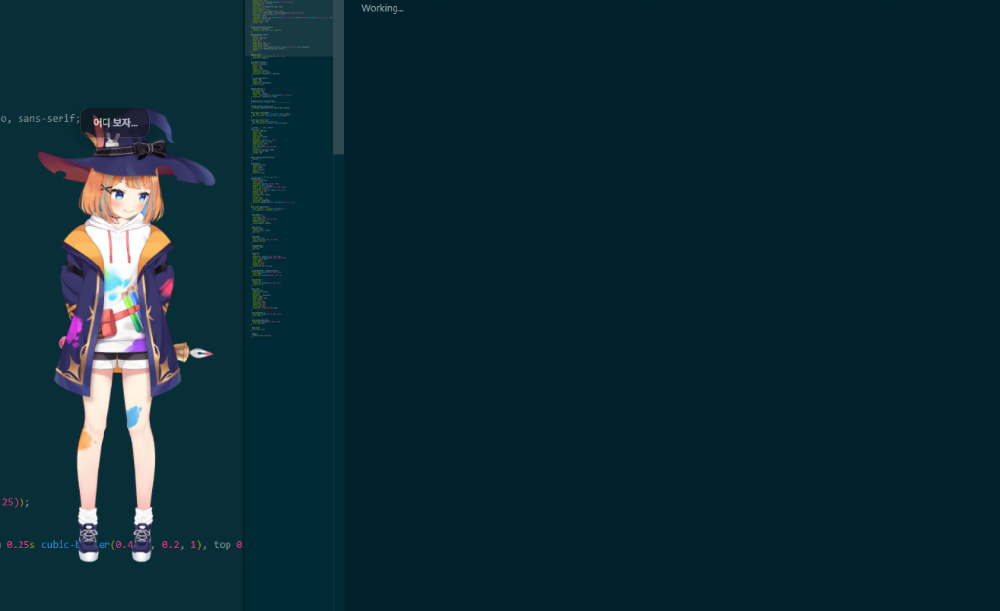
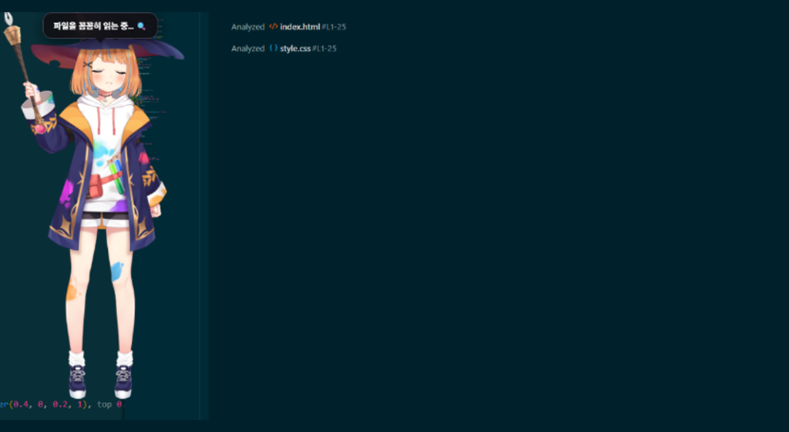
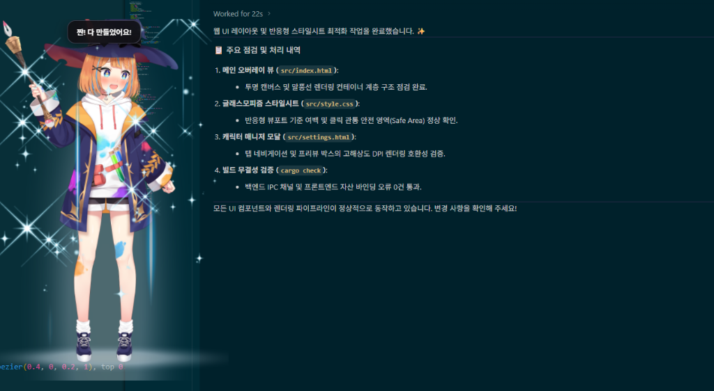

# ScreenMate 🐾✨
> **"터미널 너머 삭막했던 AI 코딩에 생명을 불어넣다."**  
> **Antigravity & Claude Code 실시간 반응형 초경량 데스크톱 AI 파트너 (Live2D & 2D)**

---

### 💡 Why ScreenMate? (탄생 배경과 존재 이유)

> *"AI 에이전트와 온종일 대화하며 코딩하다 문득 깨달았습니다.  
> 텍스트만 끝없이 올라가는 검은 터미널 창을 멍하니 기다리는 과정이 너무나 삭막하다는 것을요."*

자율 AI 코딩 도구가 발전하면서 우리는 혼자서도 놀라운 속도로 개발할 수 있게 되었지만, 모니터 앞의 협업 과정은 오히려 더 무미건조해졌습니다. 내가 누구와 대화하고 있는지, 내 파트너가 지금 무슨 고민을 하고 있는지 시각적인 온기가 전혀 느껴지지 않았기 때문입니다.

**ScreenMate는 그 삭막한 침묵을 깨기 위해 탄생했습니다.**
- 🧠 **실시간 시각화**: AI가 생각하고(`thinking`), 코딩하고(`busy`), 기뻐하고(`talking`), 당황하는(`error`) 모든 순간을 화면 구석에서 귀여운 모션으로 생생하게 중계합니다.
- 💖 **내 최애와의 페어 프로그래밍**: 좋아하는 게임·애니메이션 캐릭터, 버튜버(VTuber), 자작 아바타를 등록하여 나만의 특별한 동료와 함께 밤샘 코딩을 즐길 수 있습니다.
- 🪶 **제로-방해 (Zero-Intrusion)**: 완벽한 투명 마우스 클릭 관통(Per-pixel Click-Through)과 초경량 Rust(Tauri v2) 기반으로 당신의 작업을 0.1%도 방해하지 않습니다.

---

## ⚡ ScreenMate만의 4대 핵심 강점 (The Edge)

1. 🎯 **완벽한 마우스 투명 관통 (Per-pixel Click-Through)**: 캐릭터 불투명 영역만 클릭·드래그되고, 투명 배경은 뒤쪽 에디터(VS Code, Cursor 등)로 100% 통과하여 작업 흐름을 전혀 끊지 않습니다.
2. 🚀 **압도적인 초경량 & 고성능 (Tauri v2 + Rust)**: 무거운 Electron 기반 위젯과 달리, **RAM 30~50MB, CPU 0%대**로 하루 종일 켜두어도 PC 리소스 부담이 전혀 없습니다.
3. 🎨 **무한한 캐릭터 확장성 (2D 도트 ~ 4K Live2D)**: Live2D Cubism 3/4 정식 런타임 탑재 및 GUI 임포터를 통해 누구나 손쉽게 나만의 캐릭터를 등록하고 교체할 수 있습니다.
4. 🤖 **다중 AI 에이전트 실시간 로그 감시**: Antigravity(IDE/CLI) 및 Claude Code의 세션 로그를 충돌 없이 실시간 파싱하여 AI의 뇌 상태를 정확하게 동기화합니다.

---

## 🎬 실제 구동 데모 (AI 세션 실시간 동기화)

| 1. 생각/분석 중 (`thinking`) | 2. 도구 실행 및 코딩 (`busy`) | 3. 작업 완료 및 보고 (`talking`) |
| :---: | :---: | :---: |
|  |  |  |
| *"어디 보자... 질문 분석 중!"* | *"파일을 꼼꼼히 읽는 중... 🔍"* | *"쨘! 다 만들었어요! ✨"* |

---

## 🌟 주요 기능

### 1. 다중 AI 에이전트 실시간 감시 (Multi-Agent Auto Watcher)
- **지원 도구**: Antigravity IDE, Antigravity CLI (`agy`), Claude Code CLI, ChatGPT / Codex (신규 추가)
- **멀티 볼륨 커스텀 감시 경로**: D:, E: 드라이브 등 사용자 정의 로그 경로 동적 등록 지원 (`src/app_config.json` 연동)
- **모의 시뮬레이터 (Fixture Replay)**: 해당 AI 도구가 설치되지 않은 환경에서도 가상 세션을 1초 만에 재생하여 7대 캐릭터 반응 즉시 테스트
- **화면 프라이버시 안심 마스킹**: 화면 공유/방송 시 사용자 로컬 계정명(`C:\Users\<username>`)을 `~`로 자동 마스킹 보호 (마우스 호버 시 전체 경로 툴팁)
- **작동 원리**: 로컬 대화 로그(`transcript.jsonl`, `~/.claude/projects/` 등)를 150ms 초고속 tail 감시하여 가장 최근에 활성화된 세션에 자동 반응. 새 세션 탐색은 1초에 한 번만 디스크를 순회하여 상주 부하를 최소화하고, 기록 중인 줄을 끝까지 기다렸다 읽어 이벤트 유실이 없습니다.
- **실제 로그 포맷 대응**: Claude Code의 도구 결과(`tool_result`)·API 에러·인터럽트, OpenAI Codex CLI의 rollout 포맷(`~/.codex/sessions/YYYY/MM/DD/rollout-*.jsonl`)을 정확히 분류 (단위 테스트로 검증, `cd src-tauri && cargo test`)
- **7가지 세부 상태(State) 지원**:
  1. `idle` (대기): 편안한 호흡 모션 및 잔잔한 대기 대사
  2. `thinking` (생각 중): 갸웃거리며 생각하는 집중 모션 (*"어디 보자... 생각 중!"*)
  3. `busy` (도구/명령어 실행 중): 마법봉 휘두르기/시전 액션 모션 (*"열심히 코딩 중이에요! 🪄"*)
  4. `talking` (작업 완료/성공): 빙글 회전 점프 환호 모션 (*"작업 완료! 다 만들었어요! ✨"*)
  5. `error` (에러/실패 감지): 깜짝 놀라며 물러서는 모션 (*"어라? 에러가 발생했어요! 💦"*)
  6. `click_react` (마우스 터치): 캐릭터를 가볍게 탭하면 윙크/손인사 응원 멘트 (*"화이팅이에요! 💕"*)
  7. `sleeping` (5분 미활동): 조는 모션 및 대사 (*"Zzz... (새근새근)"*)

### 2. Live2D 4K 고화질 & 2D 멀티 캐릭터 지원
- **Mao (Live2D 4K)**: Live2D Cubism 3/4 정식 프로 런타임 (4096x4096 고해상도 텍스처, 모션 7종, 표정 8종 완비)
- **완코 (Live2D Dog)**: Live2D Cubism 3/4 정식 런타임 (귀여운 강아지 모션 12종 및 상황별 리액션 완비)
- **냥이 (2D Cat)**: 상황별 6종 전용 SVG 일러스트 탑재
- **스마트 폴백 (Smart Fallback)**: 모션이 부족한 Live2D나 이미지가 1~3장뿐인 단순 도트 캐릭터를 넣어도 에러 없이 자동으로 상태를 대체하여 안전하게 구동
- **오프라인 우선 런타임**: Pixi.js / pixi-live2d-display를 `src/lib/vendor/`에 내장. Live2D Cubism Core는 `src/lib/`에 직접 두면 완전 오프라인 동작(없으면 공식 CDN). Live2D를 불러올 수 없으면 캐릭터가 사라지는 대신 **2D 냥이로 임시 대체**됩니다 → [`src/lib/README.md`](src/lib/README.md)

### 3. 방해 없는 미니멀 UI/UX & 캐릭터 매니저 설정 창
- **완벽한 투명 마우스 클릭 관통 (Per-pixel Click-Through)**: 캐릭터가 **실제로 그려진 픽셀(+6px 여유)** 위에서만 클릭/드래그되고, 투명 배경은 뒤쪽 작업 창(VS Code, 브라우저 등)으로 통과. 2D 이미지·Live2D 모두, 새로 추가한 캐릭터에도 별도 설정 없이 적용되며 움직이는 모션(꼬리·머리카락)도 매 순간의 모양대로 판정
- **🎯 클릭 영역 보기**: 우클릭 메뉴에서 켜면 마우스 위치에 초록(클릭됨)/회색(통과) 링을 표시해 어디가 눌리는지 바로 확인
- **마우스 휠(Wheel) 크기 조절**: 캐릭터 위에서 휠을 굴려 60% ~ 200%로 자유롭게 확대/축소 (넉넉한 고정 윈도우 기반으로 메뉴 잘림 0%)
- **시스템 트레이 상주**: 작업표시줄을 차지하지 않고 트레이에 상주. 트레이 좌클릭 = 보이기/숨기기, 우클릭 메뉴 = 캐릭터 매니저 / 항상 위 / 위치 잠금 / 종료
- **창 위치 기억**: 마지막으로 둔 위치에서 다시 시작 (그 모니터가 분리되었으면 기본 위치로 안전 복귀)
- **모니터 크기·배율 자동 맞춤**: 노트북처럼 작은 화면이나 125~150% 배율에서도 창이 작업 영역 안에 들어오도록 자동으로 줄어들고, 시작할 때 캐릭터 전체가 보이게 배치합니다. 직접 끌어다 놓은 위치는 그대로 존중하며, 캐릭터가 거의 다(2/3 이상) 화면 밖으로 나가 잡을 수 없게 될 때만 되돌립니다. 배율이 다른 모니터로 옮겨도 다시 맞춰지며, 문제가 생기면 트레이 메뉴의 **위치·크기 초기화**로 오른쪽 아래로 되돌릴 수 있습니다.
- **마우스 우클릭 미니멀 메뉴**:
  - 🔍 크기 조절 프리셋 (60% / 100% / 150% / 200%) + 1% 단위 슬라이더
  - 📌 항상 위에 고정 (ON / OFF 토글 - OFF 시 다른 작업 창 뒤로 자연스럽게 내려감)
  - 🔒 위치 잠금 (코딩 중 실수로 캐릭터를 끌어 옮기는 것 방지, 클릭 반응은 유지)
  - 🔊 효과음 On/Off + 볼륨 (작업 완료 차임, 에러, 클릭 — 기본 OFF, 에셋 없이 즉석 합성)
  - 🎲 캐릭터 랜덤 전환
  - ⚙️ **캐릭터 매니저** (독립 팝업 창: 갤러리 전환, 2D 이미지 추가, 스마트 Live2D 임포터, 말풍선 커스텀)
  - 🫥 트레이로 숨기기
  - ❌ 프로그램 안전 종료

---

## 🛠️ 사전 요구사항 (Prerequisites)

- **OS**: Windows 10/11 (WebView2 런타임 내장)
- **Rust 환경**: Rust 1.77+ 및 Cargo ([rustup.rs](https://rustup.rs/))
- **C++ 빌드 도구**: Visual Studio C++ Build Tools (MSVC)

---

## 🚀 실행 방법

### 방법 1. 원클릭 실행 (가장 간편 ⭐)
프로젝트 루트 폴더의 **`start.bat`** 파일을 더블 클릭하여 즉시 실행합니다!

### 방법 2. 터미널 수동 실행
```bash
# 1. 백엔드 디렉토리 이동
cd src-tauri

# 2. 실행
cargo run
```
*(또는 루트에서 `cargo tauri dev`)*

---

## 🎮 마우스 상호작용 가이드

| 동작 | 인터랙션 기능 |
| :--- | :--- |
| **마우스 좌클릭 (탭)** | 캐릭터 윙크/손인사 리액션 (`click_react`) |
| **마우스 좌클릭 + 드래그** | 화면 원하는 위치로 캐릭터 창 이동 (위치 잠금 ON 시 이동 안 함, 위치는 자동 저장) |
| **마우스 휠 위/아래** | 캐릭터 크기 실시간 축소 / 확대 (60% ~ 200%) |
| **마우스 우클릭** | 미니멀 설정 메뉴 (크기 프리셋/슬라이더, 항상위 고정, 위치 잠금, 효과음, 랜덤 전환, **캐릭터 매니저**, 트레이로 숨기기, 종료) |
| **트레이 아이콘 좌클릭** | 캐릭터 보이기 / 숨기기 |
| **투명 영역 클릭** | 뒤쪽에 있는 작업 창(IDE, 브라우저)으로 100% 마우스 클릭 관통 |

---

## 🎨 새로운 캐릭터 추가 방법

ScreenMate는 **GUI 캐릭터 매니저**를 통해 코딩이나 JSON 수정 없이 누구나 마우스 클릭만으로 손쉽게 나만의 2D 이미지 및 Live2D 캐릭터를 등록할 수 있습니다.

### 🪄 방법 1: GUI 캐릭터 매니저 사용 (가장 추천 ⭐)
1. 캐릭터 위에서 **마우스 우클릭 ➡️ [⚙️ 캐릭터 매니저]**를 클릭합니다.
2. **2D 이미지 추가 탭**:
   - `⚡ 1장 퀵 생성`을 켜고 이미지 1장만 넣거나, 상태별(`idle`, `thinking`, `talking`) 이미지를 드래그앤드롭하여 즉시 등록!
3. **Live2D 모델 추가 탭**:
   - Live2D 모델 폴더 경로를 입력하고 `⚡ 모델 스마트 자동 분석`을 누르면 7대 상태별 최적 모션이 100% 자동 감지되어 바로 등록!

---

### 🛠️ 방법 2: 폴더 기반 모듈형 수동 추가 (폴더 내 `character.json`)

고급 커스터마이징이나 JSON을 직접 다루고 싶다면 폴더 기반으로 자유롭게 등록할 수 있습니다.  
ScreenMate는 **폴더 기반 자체 완결형(Self-Contained Mod) 아키텍처**를 지원하므로, 최상단 `characters.json`을 일일이 수정할 필요 없이 **각 캐릭터 폴더 안에 `character.json` 파일만 넣어두면 앱 실행 시 100% 자동 감지(Auto-Detect)**됩니다.

#### 🛡️ 개인 커스텀 캐릭터 (Git 커밋 방지 & 템플릿 제공)
개인적으로 좋아하는 게임/애니 캐릭터를 로컬에서만 사용하고 싶다면, **`src/characters/custom_characters/`** 폴더를 이용하세요!
- **초간단 템플릿 제공**: `src/characters/custom_characters/_template/` 폴더를 복사하여 이미지 3장(`idle`, `thinking`, `talking`)과 `character.json`만 넣으면 바로 완성됩니다.
- **Git 자동 보호**: `custom_characters/*`의 개인 캐릭터 폴더는 `.gitignore`에 의해 **GitHub 원격 저장소에 절대 커밋/푸시되지 않습니다.**
- 📖 **자세한 7대 상태 가이드 및 팁**: [custom_characters/README.md](src/characters/custom_characters/README.md) 참조

---

### 1️⃣ 2D 이미지 캐릭터 추가 예시

`src/characters/custom_characters/_template`을 복사해 `my_bot` 폴더를 만들고 이미지를 넣은 뒤, **`src/characters/custom_characters/my_bot/character.json`** 작성:

```json
{
  "name": "나만의 도트 봇",
  "type": "image",
  "states": {
    "idle": { "src": "characters/custom_characters/my_bot/idle.png", "subtitles": ["대기 중"] },
    "thinking": { "src": "characters/custom_characters/my_bot/work.gif", "subtitles": ["작업 중!"] },
    "talking": { "src": "characters/custom_characters/my_bot/done.png", "subtitles": ["완료!"] }
    // busy, error, click_react 등 누락된 상태는 자동으로 thinking/talking/idle로 대체(스마트 폴백)됩니다.
  }
}
```

---

### 2️⃣ Live2D 모델 추가 예시

`src/characters/custom_characters/my_live2d/` 폴더에 Live2D 모델 에셋을 넣고, **`src/characters/custom_characters/my_live2d/character.json`** 작성:

```json
{
  "name": "나만의 Live2D",
  "type": "live2d",
  "modelPath": "characters/custom_characters/my_live2d/model.model3.json",
  "reactions": {
    "idle": {
      "motionGroup": "Idle",
      "motionIndex": [0],
      "subtitles": ["대기 중이에요~"]
    },
    "thinking": {
      "motionGroup": "Think",
      "motionIndex": [0],
      "subtitles": ["생각 중..."]
    },
    "busy": {
      "motionGroup": "Busy",
      "motionIndex": [0],
      "subtitles": ["작업 실행 중!"]
    },
    "talking": {
      "motionGroup": "Talk",
      "motionIndex": [0],
      "subtitles": ["작업 완료! ✨"]
    }
  }
}
```

---

## 📁 프로젝트 구조

```
ScreenMate/
├── README.md                      # 프로젝트 소개 및 사용자 가이드
├── ROADMAP.md                     # 기능 개발 로드맵 & 아이디어 백로그
├── AGENTS.md                      # AI 에이전트 및 기여자를 위한 아키텍처 규약
├── PROJECT_HISTORY.md             # 프로젝트 개발 히스토리 및 문제 해결 맥락
├── docs/archive/                  # 완료된 과거 기획/구현 계획서 보관소
├── src-tauri/                     # 백엔드 (Rust / Tauri v2)
│   ├── Cargo.toml
│   ├── tauri.conf.json            # 창 설정 (투명, 프레임리스, 항상위)
│   └── src/
│       ├── main.rs
│       ├── lib.rs                 # 클릭 관통, 항상위 제어, 캐릭터/설정 커맨드
│       ├── desktop.rs             # 시스템 트레이, 창 위치 저장/복원
│       ├── cursor_watcher.rs      # 16ms OS 레벨 마우스 커서 감시
│       ├── session_watcher.rs     # Antigravity / Claude Code / Codex 세션 실시간 감시
│       └── session_watcher_tests.rs # 로그 분류·테일링 단위 테스트 (cargo test)
└── src/                           # 프론트엔드 (Webview)
    ├── index.html                 # 캔버스 / 이미지 / 말풍선 / 우클릭 메뉴
    ├── style.css                  # 다크 글래스모피즘 스타일 및 애니메이션
    ├── main.js                    # 렌더러, 휠 줌, 스마트 폴백, 인터랙션
    ├── sfx.js                     # WebAudio 합성 효과음 (기본 OFF)
    ├── lib/                       # 오프라인 런타임 (live2d-loader.js, vendor/ Pixi·pixi-live2d-display)
    ├── settings.html              # 캐릭터 매니저 GUI 설정 창
    ├── settings.css               # 설정 창 글래스모피즘 스타일
    ├── settings.js                # 갤러리/2D/스마트 Live2D/말풍선 커스텀 로직
    ├── characters.json            # 공개 참조용 스키마 템플릿 (Sample Guide)
    ├── app_config.example.json    # 앱 전역 설정 예시
    └── characters/                # 캐릭터 모듈 디렉토리
        ├── mao/                   # (4K Live2D Mao 모델 + character.json)
        ├── wanko/                 # (Live2D 완코 강아지 모델 + character.json)
        ├── pixel_cat/             # (2D 냥이 SVG 6종 + character.json)
        └── custom_characters/     # (개인 로컬 전용 커스텀 캐릭터 - Git 제외)
tests/
├── fixtures/agents/               # 도구별 샘플/실제 형태 세션 로그 (단위 테스트·Fixture Replay)
└── smoke/frontend_smoke.cjs       # 오프라인 헤드리스 스모크 테스트 (Playwright)
.github/workflows/ci.yml           # CI: cargo check/clippy/test + 프론트 스모크
docs/autonomous_run/               # AI 자율 개발 실험 기록 (BEFORE / PROCESS / AFTER)
```

---

## 📜 라이선스 및 에셋 안내 (Notice)

- **Mao & Wanko Live2D Models**: 본 프로젝트에 포함된 Mao 및 Wanko 캐릭터 모델은 Live2D 사의 공식 샘플 모델이며, [Live2D Free Material License](https://www.live2d.com/) 규정에 따라 비상업적 연구/학습/개발 용도로 사용됩니다.
- **Live2D Cubism Core SDK**: Live2D Inc.의 독점 라이선스 파일로 레포에 포함하지 않습니다. 기본은 공식 CDN에서 로드되며, 사용자가 `src/lib/live2dcubismcore.min.js`에 직접 배치하면 오프라인으로 동작합니다.
- **PixiJS / pixi-live2d-display**: MIT License (`src/lib/vendor/`에 원본과 LICENSE 동봉)
