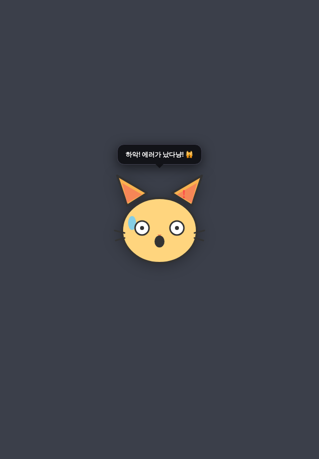
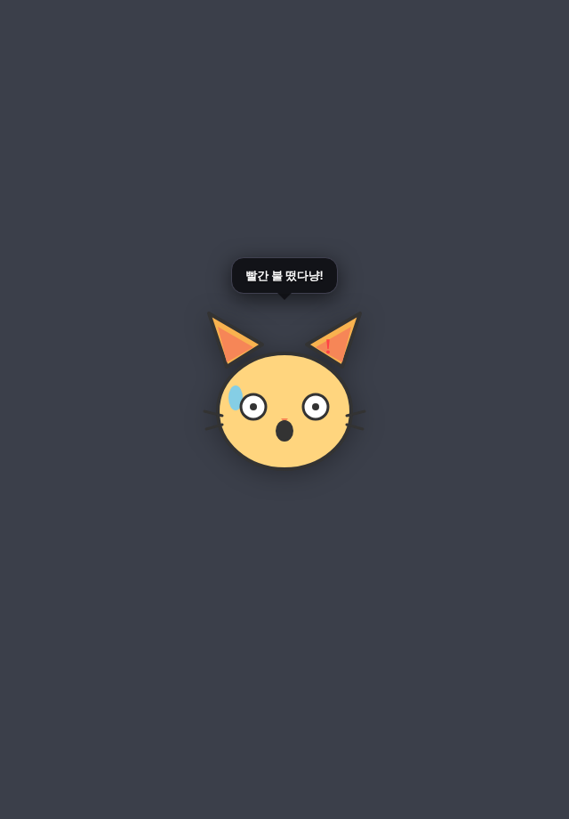
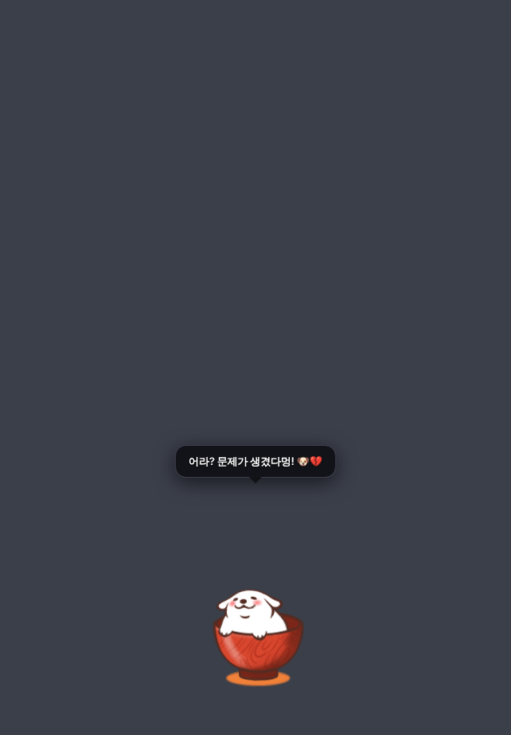
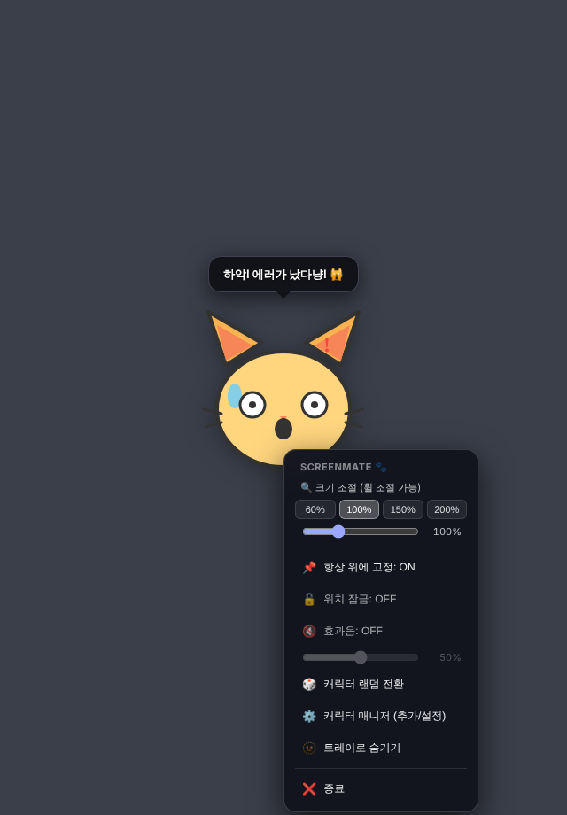

# 03. AFTER — 작업 후 측정 & BEFORE 비교

> 측정 시점: 자율 개발 마지막 커밋 직전, BEFORE와 **같은 컨테이너·같은 명령**으로 재측정
> 원본 출력: `raw/after_*` (BEFORE는 `raw/before_*`)

---

## 1. 비교표

| 지표 | BEFORE | AFTER | 원본 |
| :--- | :--- | :--- | :--- |
| `cargo check` | ✅ 경고 0 | ✅ 경고 0 | — |
| `cargo clippy` | ⚠️ 경고 3 | ✅ **경고 0** (`--all-targets -D warnings` 기준) | `raw/after_clippy.txt` |
| 자동화 테스트 수 | 0 | **26** (+벤치 1) | `raw/after_cargo_test.txt` |
| 특성 테스트 결과 | 7 통과 / **7 실패** | **26 통과 / 0 실패** | 같은 파일 |
| 세션 탐색 CPU 비용 (2,000파일) | ≈19.9 ms/s (150ms마다 순회) | **≈1.8 ms/s** (1초마다 순회, 같은 측정에서 구 방식 환산 12.3 ms/s) | `raw/after_bench.txt` |
| 오프라인: 기본 캐릭터 Mao | ❌ 미표시, 무반응, `PIXI is not defined` | ✅ **냥이로 대체 표시 + 원인 안내**, 상태 반응 정상 | `raw/after_smoke.json`, `screens/after_mao.png` |
| 오프라인 + Core 로컬 배치: Wanko(Live2D) | (측정 불가: Pixi가 CDN 전용) | ✅ **Live2D 렌더링, 외부 요청 0건** | `raw/after_smoke_localcore.json`, `screens/after_localcore_wanko.png` |
| 오프라인 차단된 외부 요청 수 | 3 (Core, Pixi, 플러그인) | 1 (Core CDN만, 로컬 Core 있으면 0) | 위 파일들 |
| 페이지 런타임 에러 (`pageerror`) | 0 | 0 | 위 파일들 |
| CI | 없음 | `.github/workflows/ci.yml` (Rust check/clippy/test + 프론트 문법·오프라인 스모크) — 로컬에서 동일 명령 통과 | — |

> 벤치마크 절대값은 실행마다 ±30% 정도 흔들립니다(BEFORE 2.98ms/스캔, AFTER 1.84ms/스캔). 핵심 차이는 **초당 순회 횟수 6.7회 → 1회**입니다.

---

## 2. 결함별 해결 현황 (01_BEFORE의 D1~D7)

| ID | 결함 | 상태 | 근거 |
| :--- | :--- | :--- | :--- |
| D1 | 반쪽 라인 유실 | ✅ 해결 | `tail_does_not_drop_partially_written_line` 통과 |
| D2 | 150ms마다 전체 순회 | ✅ 해결 | 벤치 + `scan_counts_sessions_and_finds_latest` |
| D3 | Claude Code 실제 포맷 오분류 | ✅ 해결 | `claude_tool_result_inside_user_record_is_busy`, `claude_api_error_message_is_error`, `claude_meta_records_are_ignored`, `claude_realistic_fixture_sequence`, `claude_interrupt_returns_to_idle` 통과 |
| D4 | Codex rollout 포맷 무반응 | ✅ 해결 | `codex_rollout_records`, `codex_rollout_fixture_sequence`, `codex_injected_environment_context_is_ignored` 통과 |
| D5 | 새 세션 첫 줄 누락 | ✅ 해결 | `tail_reads_new_small_session_from_first_line` 등 3개 |
| D6 | 오프라인 시 캐릭터 소실 | ✅ 해결(대체 표시) / ⚠️ Mao 자체의 오프라인 렌더링은 최신 Core 필요 | 스모크 결과, `src/lib/README.md` |
| D7 | ROADMAP P0 미완 (트레이·위치) | ✅ 구현 / ⚠️ **실기기 미검증** | 판정 로직 단위 테스트 5개, `cargo build` 링크 성공 |

### 작업 중 추가로 발견해 고친 것 (BEFORE 목록에 없던 것)
1. Claude 프로젝트 폴더명에 `gemini`/`codex`가 들어가면 다른 도구로 오판 → `claude_project_folder_mentioning_other_tool_is_still_claude`
2. 두 세션을 번갈아 쓰면 사이 이벤트 유실 → `tail_resumes_when_alternating_between_sessions`
3. 저장된 '항상 위' OFF가 재시작 시 창에 적용되지 않음(UI만 OFF) → 시작 시 적용
4. 효과음 미리 듣기가 실제 완료음을 막음 → 스모크로 발견 후 수정
5. `app_config.json` 동시 읽기-수정-쓰기 경합 가능성 → `update_app_config()`로 직렬화

---

## 3. 스크린샷 비교 (오프라인, 외부 요청 전부 차단)

| | BEFORE | AFTER |
| :--- | :---: | :---: |
| 기본 캐릭터 Mao (Core 없음) |  |  |
| 냥이 (회귀 확인) |  |  |
| Wanko (Core 로컬 배치) | — |  |
| 우클릭 메뉴 | — |  |

> 냥이 화면은 BEFORE/AFTER가 픽셀 단위로 동일하게 보임 → 2D 경로 회귀 없음.
> 참고: 2D 냥이가 창 하단이 아닌 중간쯤에 서 있는 배치는 원래 동작이며 이번에 건드리지 않았습니다.

---

## 4. 변경 규모

```bash
git diff --stat a98bebd..HEAD -- . ':!src/lib/vendor' ':!docs/autonomous_run/raw' ':!docs/autonomous_run/screens'
```
(벤더 라이브러리·측정 원본·스크린샷 제외) 측정 시점 결과: **26 files changed, 2542 insertions(+), 257 deletions(-)** — 이 중 상당 부분은 테스트·픽스처·기록 문서입니다.

---

## 5. 정직한 한계 (이 실험이 증명하지 못한 것)

- **Windows 실기기 미실행**: 투명 창, 클릭 관통, 트레이 아이콘/메뉴, 다중 모니터 위치 복원, WebView2 오디오 정책은 이 Linux 헤드리스 컨테이너에서 실행해 볼 수 없었습니다. 컴파일·링크·단위 테스트·헤드리스 브라우저 스모크까지만 검증했습니다.
- **실제 AI 도구 로그 미사용**: Claude Code·Codex 픽스처는 알려진 로그 형태를 본떠 직접 작성했습니다. 도구 버전에 따라 필드가 다를 수 있습니다.
- **Mao 오프라인 렌더링**: 확보 가능한 Cubism Core가 구버전(2019)이라 Cubism 5 모델인 Mao는 컨테이너에서 렌더링을 확인하지 못했습니다(대체 표시는 확인).
- **원격 반영 실패**: 이 세션의 GitHub 앱 권한 문제로 `git push`가 403으로 거부되었습니다. 모든 작업은 로컬 브랜치 커밋으로 남아 있습니다(자세한 내용은 `02_PROCESS_LOG.md` 마지막 단계).

→ 위 항목은 [`04_MANUAL_TEST_CHECKLIST.md`](./04_MANUAL_TEST_CHECKLIST.md)에서 사람이 직접 확인할 수 있도록 정리했습니다.

> **이후 경과**: Windows CI(빌드·테스트·실행 확인)가 추가되었고, 원격 반영은 GitHub 권한 재연결로 해결되었습니다. 사용자의 실기기 테스트로 **이 표에서 "미검증"이던 영역에서 실제 결함이 나왔습니다**(배율 150% Live2D 위치, Windows 창 이동 제한 등). 결과와 수정 과정은 [`05_FOLLOWUP_HUMAN_LOOP.md`](./05_FOLLOWUP_HUMAN_LOOP.md)에 있습니다. 위 수치(테스트 26개 등)는 PR #1 시점 기준이며, 최종은 테스트 41개입니다.
